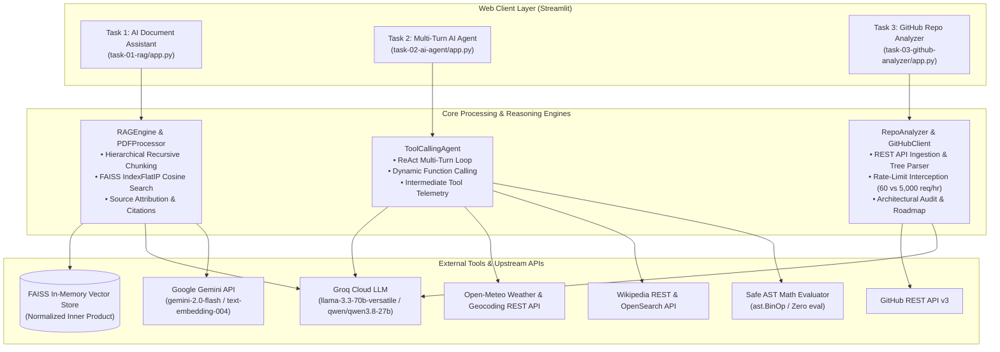

# Ghanex Tech – GenAI & Open-Source Developer Intern Technical Assessment

[](https://www.python.org/)
[](https://streamlit.io/)
[](https://groq.com/)
[](https://ai.google.dev/)
[](https://github.com/facebookresearch/faiss)
[-brightgreen.svg)]()
[](LICENSE)

Production-ready, modular monorepo containing complete implementations for all three tasks of the **Ghanex Tech Technical Assessment** for the **GenAI & Open-Source Developer Intern** role.

---

## 📑 Assessment Overview & Deliverables Matrix

| Task | Module Directory | Primary Tech Stack | Key Capabilities | Automated Tests | Deep-Dive Documentation |
| :--- | :--- | :--- | :--- | :---: | :--- |
| **Task 1: AI Document Assistant (RAG)** | [`task-01-rag/`](./task-01-rag) | Streamlit, Groq, Gemini, FAISS, PyPDF, Scikit-Learn | • Multi-page PDF parsing with encrypted/scanned file edge-case guards<br>• Recursive character chunking (`chunk_size=1000`, `chunk_overlap=200`)<br>• In-memory FAISS vector store with cosine similarity<br>• Strict anti-hallucination grounding with source citations | **23 / 23 Passed** | [Task 1 README](./task-01-rag/README.md) |
| **Task 2: Multi-Turn AI Agent** | [`task-02-ai-agent/`](./task-02-ai-agent) | Streamlit, Groq API (`llama-3.3-70b-versatile`, `qwen/qwen3.8-27b`), Requests | • Autonomous multi-turn reasoning with Groq function calling<br>• Safe AST Calculator (zero `eval()`, code execution prevention)<br>• Live Weather via Open-Meteo Geocoding & Forecast APIs<br>• Wikipedia encyclopedic search with reference citations<br>• Collapsible tool execution telemetry expander | **20 / 20 Passed** | [Task 2 README](./task-02-ai-agent/README.md) |
| **Task 3: GitHub Repository AI Analyzer** | [`task-03-github-analyzer/`](./task-03-github-analyzer) | Streamlit, GitHub REST API v3, Groq API, Pydantic | • Ingests repo metadata, raw README, recursive tree & manifests<br>• Rate-limit resilience with optional Personal Access Token (PAT)<br>• Structured 4-part architectural audit (Executive Summary, Architecture, 3 Recommendations, Good First Issues)<br>• Metric cards, tree viewer, and 1-click Markdown export | **12 / 12 Passed** | [Task 3 README](./task-03-github-analyzer/README.md) |

---

## 🏛️ High-Level System Architecture



---

## 🚀 Quickstart & Local Installation

### 1. Clone Repository & Setup Virtual Environment
```bash
# Clone the repository
git clone https://github.com/khrishChauhan/ghanextech-technical-assessment.git
cd ghanextech-technical-assessment

# Create Python 3.10+ virtual environment
python -m venv .venv

# Activate virtual environment
# Windows (PowerShell):
.venv\Scripts\Activate.ps1
# Linux / macOS:
source .venv/bin/activate

# Install consolidated dependencies for all tasks
pip install -r requirements.txt
```

### 2. Configure Environment Variables
Copy `.env.example` in any task directory or define environment variables globally:

```env
# Groq Cloud API Key (obtain from https://console.groq.com/keys)
GROQ_API_KEY=gsk_your_groq_api_key_here

# (Optional) Google Gemini API Key (obtain from https://aistudio.google.com/)
GEMINI_API_KEY=AIzaSy_your_gemini_api_key_here

# (Optional) GitHub Personal Access Token for Task 3 (increases limit from 60 to 5,000 req/hr)
GITHUB_TOKEN=ghp_your_github_token_here
```

---

## 💻 Running the Applications

Each task runs independently via Streamlit:

### Run Task 1: AI Document Assistant (RAG)
```bash
streamlit run task-01-rag/app.py
```
*Upload PDFs, ask questions, receive answers grounded in context with exact source citations.*

### Run Task 2: Multi-Turn AI Agent with Dynamic Tool Calling
```bash
streamlit run task-02-ai-agent/app.py
```
*Engage with an autonomous agent capable of live weather forecasting, safe math calculation, and Wikipedia search with real-time tool telemetry.*

### Run Task 3: GitHub Repository AI Analyzer
```bash
streamlit run task-03-github-analyzer/app.py
```
*Input any GitHub repository URL (`psf/requests`, `pallets/flask`) to generate a complete architectural audit and open-source contribution roadmap.*

---

## 🧪 Automated Test Suite (55 / 55 Passed)

Run all tests across all three tasks simultaneously:

```bash
pytest task-01-rag/tests task-02-ai-agent/tests task-03-github-analyzer/tests -v
```

### Test Breakdown:
- **Task 1 (`task-01-rag/tests/`):** 23 tests passing
  - Multi-page PDF text extraction, scanned PDF detection, encrypted PDF alerts, corrupt stream resilience.
  - Recursive text chunker parameter validation (`chunk_size=1000`, `chunk_overlap=200`).
  - FAISS `IndexFlatIP` vector store addition, cosine similarity search, and clean index reset.
  - Strict anti-hallucination prompt refusal phrase validation.
- **Task 2 (`task-02-ai-agent/tests/`):** 20 tests passing
  - Safe AST calculator arithmetic, precedence, division-by-zero protection, and security injection blocks (`__import__`, `eval()`, function calls).
  - Open-Meteo live weather valid city, empty city, and unknown city handling.
  - Wikipedia search valid lookup and nonexistent article graceful recovery.
  - Agent multi-turn reasoning loop, tool execution trace capture, and error recovery.
- **Task 3 (`task-03-github-analyzer/tests/`):** 12 tests passing
  - GitHub URL parsing (full URLs, `.git` suffixes, SSH syntax, shorthands, and invalid domain rejection).
  - Mocked repository metadata, raw README, and recursive tree ingestion.
  - Rate-limit error handling (HTTP 403 / remaining == 0) with UTC reset formatting.
  - Analyzer prompt formatting, structured section verification, and automated model fallback.

---

## 🛡️ Production Engineering & Security Practices

- **Zero-Code-Execution AST Calculator:** Complete rejection of Python's dangerous `eval()` or `exec()`. Mathematical evaluation strictly traverses an Abstract Syntax Tree (`ast.BinOp`, `ast.UnaryOp`, `ast.Constant`), intercepting code injection, attribute lookups, and division by zero.
- **Strict Grounding Guardrails:** The RAG pipeline instructs LLMs to rely solely on retrieved passages. If an answer cannot be grounded in the context, it outputs: *"The provided document(s) do not contain information regarding this question."*
- **Vector Store Isolation Lifecycle:** `clear_index()` cleanses both vector stores and in-memory metadata registries on new uploads, preventing cross-document vector leakage.
- **Zero-Downtime Model Fallbacks:** Built-in model routing between `llama-3.3-70b-versatile`, `qwen/qwen3.8-27b`, and `openai/gpt-oss-120b` ensures uninterrupted functionality regardless of specific API tier allocations.
- **Safe Secrets Handling:** API keys are never committed to git history (`.gitignore` enforces `.env` isolation). Keys can be provided via environment variables, `.env` files, or the interactive Streamlit sidebar.

---

## 📄 Submission Details

Complete submission responses, AI collaboration disclosures, and open-source contribution guidelines are documented in:
👉 **[`SUBMISSION.md`](./SUBMISSION.md)**

---

## 📜 License

This project is licensed under the MIT License — see the [LICENSE](LICENSE) file for details.
