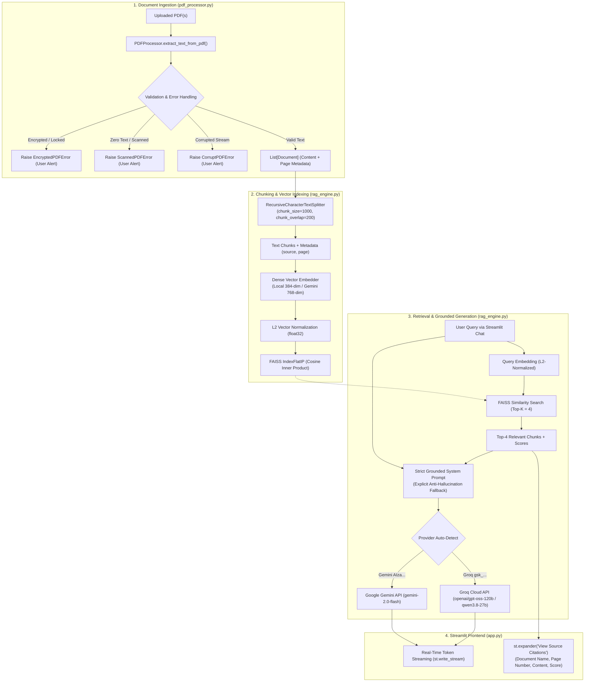

# Task 1: AI Document Assistant using Retrieval-Augmented Generation (RAG)

A complete, production-ready, modular AI Document Assistant built for the **Ghanex Tech GenAI Developer Assessment**. The system allows users to upload multi-page PDF documents and query them in natural language. Powered by **Groq** (`openai/gpt-oss-120b`, `qwen/qwen3.8-27b`) and **Google Gemini** (`gemini-2.0-flash`) with an in-memory **FAISS** vector store, the assistant returns grounded, cited answers while strictly eliminating hallucinations.

---

## 🏗️ System Architecture & Workflow



---

## 🔬 Technical Rationale & Architectural Decisions

### 1. Chunking Strategy
- **Mechanism:** `RecursiveCharacterTextSplitter` with separators `["\n\n", "\n", ". ", "? ", "! ", " ", ""]`.
- **Chunk Size (`1000` characters ≈ 200–250 tokens):**
  - Represents the standard semantic length of an informational paragraph in technical manuals, architectural specs, and policy documentation.
  - Keeps individual chunks granular enough to prevent topic dilution during vector averaging while preserving complete assertions.
- **Chunk Overlap (`200` characters ≈ 40–50 tokens):**
  - Provides a contextual bridge between consecutive chunks.
  - Guarantees that multi-sentence clauses, cryptographic formulas, and entity definitions spanning chunk boundaries are not bisected or lost during top-$k$ retrieval.

### 2. Dual-Provider LLM & Embeddings Support
- **Groq Cloud API (Ultra-Fast Inference):**
  - Flagship model: `openai/gpt-oss-120b` (131k context window, high reasoning).
  - Alternative: `qwen/qwen3.8-27b` (rapid low-latency reasoning).
  - Streaming tokens over HTTP Server-Sent Events (SSE) directly into Streamlit's `st.write_stream`.
  - Paired with local dense embeddings (384 dimensions, zero external API dependency).
- **Google Gemini API:**
  - Model: `gemini-2.0-flash` with `models/text-embedding-004` (768 dimensions).
- **L2 Normalization & Inner Product (`IndexFlatIP`):**
  All chunk vectors and query vectors are normalized to unit length ($\|v\|_2 = 1.0$). Consequently, the inner product computed by FAISS equals exact Cosine Similarity:
  $$\text{sim}(u, v) = \frac{u \cdot v}{\|u\|_2 \|v\|_2} = u_{\text{norm}} \cdot v_{\text{norm}}$$
  Similarity scores range predictably from $[-1.0, 1.0]$.

### 3. Vector Store: In-Memory FAISS
- **Zero Daemon Overhead:** Operates entirely in memory without requiring external Docker services or dedicated database servers.
- **Index Refresh Guarantee:** `RAGEngine.clear_index()` re-initializes the index and clears chunk lists upon new document uploads, guaranteeing zero stale vector leakage across sessions.

### 4. Anti-Hallucination & Grounded Generation
The system prompt strictly commands:
1. Grounding: Rely **only** on provided context passages. Do not extrapolate or guess.
2. Explicit Refusal: If the context lacks sufficient facts, output verbatim:
   > *"The provided document(s) do not contain information regarding this question."*
3. Citations: Reference exact page numbers for every factual assertion.

---

## 📁 File Structure

```
task-01-rag/
├── .env                         # Local environment variables (Groq / Gemini key)
├── .env.example                 # Template for API keys
├── requirements.txt             # Pinned project dependencies
├── README.md                    # System architecture & setup documentation
├── pdf_processor.py             # PDFProcessor class with multi-page extraction & edge handling
├── rag_engine.py                # RAGEngine class with chunking, FAISS, and Groq/Gemini integration
├── app.py                       # Modern Streamlit UI with streaming and citations
│
├── tests/                       # Complete automated unit test suite (23 tests)
│   ├── test_pdf_processor_and_engine.py
│   ├── test_pdf_loader.py
│   ├── test_chunker.py
│   ├── test_vectorstore.py
│   └── test_rag_pipeline.py
│
└── sample_docs/
    ├── generate_sample_pdf.py   # Script to regenerate multi-page test PDF
    └── sample_policy.pdf        # Ghanex Tech Engineering Handbook (3 pages)
```

---

## ⚡ Quickstart & Local Setup Instructions

### Prerequisites
- Python 3.10, 3.11, or 3.12
- A Groq Cloud API Key (starts with `gsk_...`) or Google Gemini API Key

### 1. Navigate to Project Directory
```bash
cd task-01-rag
```

### 2. Create and Activate Virtual Environment
**On Windows (PowerShell):**
```powershell
python -m venv .venv
.\.venv\Scripts\Activate.ps1
```
**On Linux / macOS:**
```bash
python3 -m venv .venv
source .venv/bin/activate
```

### 3. Install Dependencies
```bash
pip install -r requirements.txt
```

### 4. Configure Environment Variables
Inside `task-01-rag/.env`:
```ini
GROQ_API_KEY=gsk_your_groq_api_key_here
```
*(Alternatively, enter your API key directly in the sidebar password field in the web UI).*

### 5. Run the Streamlit Application
```bash
streamlit run app.py
```
Open your browser at `http://localhost:8501`.

---

## 🧪 Automated Testing

Execute the automated test suite with verbose reporting:

```bash
pytest tests -v
```

All 23 unit tests verify:
- Multi-page extraction and page metadata tagging (`source` and `page`).
- Graceful error handling for encrypted, empty, scanned, and corrupt PDFs.
- Recursive character splitting and parameter boundary enforcement.
- FAISS cosine similarity ranking and index clearing (`clear_index()`).
- Provider auto-detection (Groq vs. Gemini) and anti-hallucination refusal messages.

---

## 🛡️ Edge Case Handling

| Edge Case | Exception Raised | Streamlit UI Behavior |
|---|---|---|
| **Password-Protected PDF** | `EncryptedPDFError` | Displays a red alert informing the user to remove encryption. |
| **Scanned / Raster-Only PDF** | `ScannedPDFError` | Detects zero/low selectable characters (<25 chars) and warns that OCR or text-based PDF is required. |
| **Empty PDF (0 Pages)** | `EmptyPDFError` | Displays an alert stating the document has no pages. |
| **Corrupted PDF File** | `CorruptPDFError` | Catches `pypdf` read failures gracefully without crashing. |
| **Missing API Key** | User validation | Highlights amber status indicator and prompts for API key in the sidebar. |
| **Unrelated User Query** | Strict system prompt | Outputs: *"The provided document(s) do not contain information regarding this question."* |

---

## 🌐 Streamlit Community Cloud Deployment

1. Push this repository to your public GitHub account.
2. Sign in to [share.streamlit.io](https://share.streamlit.io/).
3. Select **"Create app"** with:
   - **Repository:** `your-username/ghanextech-technical-assessment`
   - **Branch:** `main`
   - **Main file path:** `task-01-rag/app.py`
4. In **Advanced Settings -> Secrets**, add:
   ```toml
   GROQ_API_KEY = "gsk_your_key_here"
   ```
5. Click **Deploy!**
