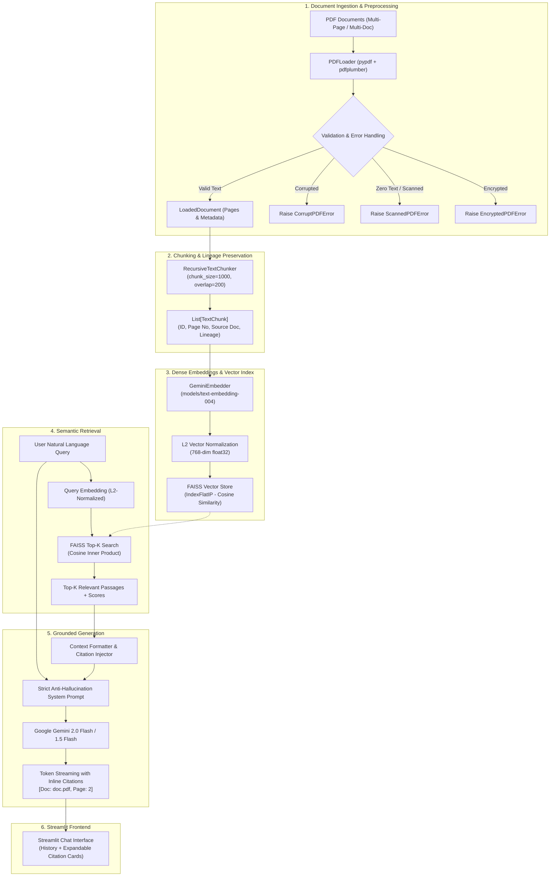

# Task 1: Production-Ready RAG Document Assistant

A modular, enterprise-grade AI Document Assistant built with **Retrieval-Augmented Generation (RAG)**. Users can upload multi-page PDF documents and query them using natural language. The system retrieves semantically relevant passages and generates grounded, cited responses powered by **Google Gemini** and **FAISS**, preventing hallucinations through strict prompt engineering and similarity thresholds.

---

## 🏗️ System Architecture & Workflow

The architecture follows a decoupled, modular pipeline designed for testability, scalability, and zero-leakage context management:



---

## 🔬 Architectural Choices & Rationale

### 1. Chunking Strategy
- **Mechanism:** Recursive character text splitting using a hierarchical separator sequence (`["\n\n", "\n", ". ", "? ", "! ", "; ", ", ", " ", ""]`).
- **Chunk Size (`1000` characters ≈ 200–250 tokens):**
  - Matches the typical paragraph length in engineering, legal, financial, and policy documentation.
  - Balances semantic completeness with embedding granularity. Smaller chunks (e.g., 200 chars) lose contextual coherence, while larger chunks (>3000 chars) dilute specific facts when averaged into a single dense vector.
- **Chunk Overlap (`200` characters ≈ 40–50 tokens):**
  - Maintains semantic continuity across chunk boundaries, ensuring that definitions, clauses, or entity mentions spanning adjacent chunks are not lost during retrieval.
- **Metadata Lineage:** Every chunk carries its originating `source_name`, `page_number`, and sequential `chunk_index`. This guarantees that generated responses can pinpoint the exact page and paragraph for citations.

### 2. Embedding Model: Google `models/text-embedding-004`
- **Dimensionality:** 768-dimensional dense embeddings.
- **Precision & Benchmarks:** Ranked among the highest performers on the Massive Text Embedding Benchmark (MTEB) for retrieval and classification tasks.
- **L2 Normalization & Inner Product (`IndexFlatIP`):** By normalizing all embeddings ($\|v\|_2 = 1.0$), the inner product calculated by FAISS is mathematically identical to cosine similarity:
  $$\text{sim}(u, v) = \frac{u \cdot v}{\|u\|_2 \|v\|_2} = u_{\text{norm}} \cdot v_{\text{norm}}$$
  This allows rapid retrieval with exact cosine scores bound between $[-1.0, 1.0]$.

### 3. Vector Database: FAISS (`faiss-cpu`)
- **Lightweight & In-Memory:** Requires zero external server daemon, database setup, or Docker containers.
- **Thread-safe & Deterministic:** Excellent for fast session-based indexing and multi-document retrieval within Streamlit.
- **Persistence:** Supports local serialization to disk (`index.faiss` + `metadata.json`) for session restore.

### 4. Grounded Generation & Anti-Hallucination Guardrails
The system prompt strictly instructs the LLM:
1. **Context Grounding:** The model is prohibited from using prior world knowledge to answer queries not supported by the context.
2. **Explicit Fallback:** If the context lacks sufficient information, the model must explicitly return:
   > *"Based on the provided documents, I could not find information regarding [topic]."*
3. **Mandatory Inline Citations:** Factual claims must reference source documents and page numbers (e.g., `[Document: handbook.pdf, Page: 2]`).

---

## 📂 Project Structure

```
task-01-rag/
│
├── .env.example                 # Example environment variables template
├── requirements.txt             # Pinned project dependencies
├── README.md                    # Comprehensive documentation and setup guide
├── app.py                       # Main Streamlit web application
│
├── config/                      # Configuration and environment management
│   ├── __init__.py
│   └── settings.py              # Centralized dataclass settings & key resolvers
│
├── src/                         # Modular core source code
│   ├── __init__.py
│   ├── ingestion/               # Document parsing and chunking
│   │   ├── __init__.py
│   │   ├── pdf_loader.py        # Robust multi-page PDF ingestion with error handling
│   │   └── chunker.py           # Recursive text chunking preserving metadata
│   │
│   ├── embeddings/              # Embedding generation
│   │   ├── __init__.py
│   │   └── gemini_embeddings.py # Gemini text-embedding-004 client with retries
│   │
│   ├── vectorstore/             # Vector indexing and similarity search
│   │   ├── __init__.py
│   │   └── faiss_store.py       # FAISS IndexFlatIP store with metadata mapping
│   │
│   ├── generation/              # Grounded synthesis
│   │   ├── __init__.py
│   │   ├── prompts.py           # Grounding and anti-hallucination prompt templates
│   │   └── rag_engine.py        # Pipeline orchestrator with token streaming
│   │
│   └── utils/                   # Utilities
│       ├── __init__.py
│       └── logger.py            # Structured console logger
│
├── tests/                       # Complete automated unit test suite
│   ├── __init__.py
│   ├── test_pdf_loader.py       # Tests for corrupt, encrypted, and empty PDFs
│   ├── test_chunker.py          # Tests for chunk boundaries, sizes, and metadata
│   ├── test_vectorstore.py      # Tests for FAISS indexing, similarity, and persistence
│   └── test_rag_pipeline.py     # Tests for prompt formatting, grounding, and retrieval
│
└── sample_docs/                 # Sample documents for instant demo and evaluation
    ├── generate_sample_pdf.py   # Script to regenerate sample corporate policy PDF
    └── sample_policy.pdf        # Ghanex Tech Engineering Architecture Handbook (3 pages)
```

---

## ⚡ Quickstart & Local Installation

### Prerequisites
- Python 3.10, 3.11, or 3.12
- A free Google Gemini API Key ([Get one here](https://aistudio.google.com/app/apikey))

### 1. Clone & Navigate to Task Directory
```bash
cd task-01-rag
```

### 2. Create and Activate Virtual Environment
**On Linux/macOS:**
```bash
python3 -m venv .venv
source .venv/bin/activate
```

**On Windows (PowerShell):**
```powershell
python -m venv .venv
.\.venv\Scripts\Activate.ps1
```

### 3. Install Dependencies
```bash
pip install -r requirements.txt
```

### 4. Configure Environment Variables
Copy `.env.example` to `.env` and set your API key:
```bash
cp .env.example .env
```
Inside `.env`:
```ini
GEMINI_API_KEY=AIzaSyYourGeminiApiKeyHere
```
*(Alternatively, you can paste the API key directly into the sidebar field in the web UI at runtime).*

### 5. Run the Streamlit Application
```bash
streamlit run app.py
```
The application will launch in your browser at `http://localhost:8501`.

---

## 🧪 Running Unit Tests

Run the complete test suite with verbose output:

```bash
pytest tests -v
```

All 16 unit tests cover:
- Multi-page PDF text extraction and character counting.
- Error handling for password-protected, empty, and scanned documents.
- Recursive character splitting, overlap boundaries, and chunk metadata tracking.
- FAISS cosine similarity scoring, index resets, and local serialization.
- Grounding prompts, citation injection, and end-to-end retrieval pipelines.

---

## 🌐 Live Deployment Guide (Streamlit Community Cloud)

1. Push your repository to GitHub.
2. Visit [share.streamlit.io](https://share.streamlit.io/) and log in with GitHub.
3. Click **"New App"** and select:
   - **Repository:** `your-username/ghanextech-technical-assessment`
   - **Branch:** `main`
   - **Main file path:** `task-01-rag/app.py`
4. Expand **Advanced Settings** -> **Secrets** and add:
   ```toml
   GEMINI_API_KEY = "AIzaSyYourGeminiApiKeyHere"
   ```
5. Click **Deploy!** The application will build and deploy on a public URL.

---

## 🛡️ Edge Case Handling

| Scenario | Behavior / Exception | User Experience |
|---|---|---|
| **Password-Protected PDF** | `EncryptedPDFError` | Displays a clear alert prompting the user to remove encryption. |
| **Scanned / Raster-Only PDF** | `ScannedPDFError` | Detects zero extractable text (<25 chars) and instructs user that machine-readable text is required. |
| **Empty PDF (0 Pages)** | `EmptyPDFError` | Informs user that the document is empty. |
| **Corrupted PDF File** | `CorruptPDFError` | Catches `pypdf` reading errors and displays an informative error card without crashing. |
| **Unrelated Query** | Strict system prompt | Returns explicit refusal: *"Based on the provided documents, I could not find information regarding [topic]."* |
| **Missing API Key** | `GeminiAPIKeyError` | Shows amber badge and input field in sidebar; prevents invalid API requests. |

---

## 🚀 Known Limitations & Roadmap

1. **OCR for Scanned Documents:** Currently requires machine-readable text. Integrating Tesseract OCR or Google Cloud Vision would enable ingesting scanned document images.
2. **Hybrid Search (BM25 + Dense):** Combining sparse keyword retrieval (BM25) with dense embeddings would improve precision on exact acronyms and part numbers.
3. **Cross-Encoder Reranking:** Adding a lightweight reranker (e.g., Cohere Rerank or BGE-Reranker) before context injection would further boost passage relevance.
