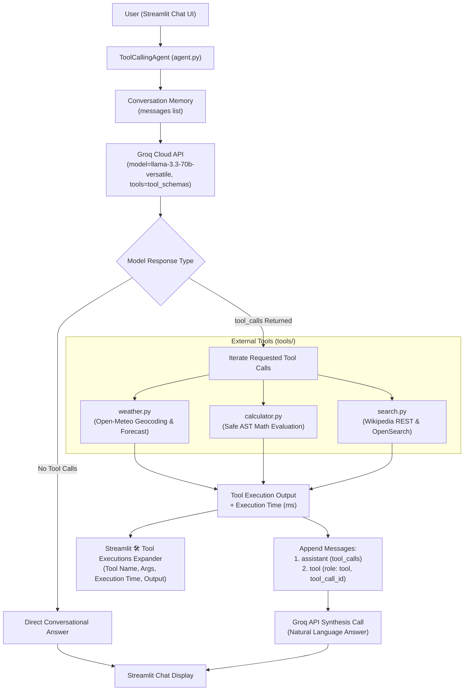

# Task 2: Multi-Turn AI Agent with Dynamic Tool Calling

A complete, production-ready, modular Multi-Turn AI Agent powered by the **Groq API** (`llama-3.3-70b-versatile`, `llama-3.1-8b-instant`, `qwen/qwen3.8-27b`, and `openai/gpt-oss-120b`) utilizing native OpenAI-compatible function calling. The agent dynamically decides whether to converse directly or invoke external tools (Safe AST Calculator, Live Weather, Wikipedia Knowledge Search), manages conversation memory across turns, handles multi-tool reasoning sequences, and presents synthesized responses with interactive tool execution telemetry.

---

## 🏗️ Architecture & Tool Orchestration Flow



---

## 📁 Project Directory Structure

```
task-02-ai-agent/
├── .env.example              # Environment variables template
├── requirements.txt          # Pinned production dependencies
├── agent.py                  # ToolCallingAgent with full multi-turn function calling loop
├── app.py                    # Streamlit web application with tool inspection expander
├── README.md                 # Complete system documentation and architecture guide
├── tools/                    # Modular external tools package
│   ├── __init__.py           # Standard tool registry, schemas, and function dispatch
│   ├── weather.py            # Open-Meteo Live Weather & Geocoding tool
│   ├── calculator.py         # Safe AST mathematical calculator (strict security)
│   └── search.py             # Wikipedia encyclopedic summary & search tool
└── tests/                    # Automated unit and integration test suite
    ├── conftest.py           # Pytest path and environment configuration
    ├── test_weather.py       # Open-Meteo weather tool tests
    ├── test_calculator.py    # Safe AST calculator and security injection tests
    ├── test_search.py        # Wikipedia search tool tests
    └── test_agent.py         # Multi-turn reasoning and tool calling agent loop tests
```

---

## 🛠️ Tool Specifications & Input Schemas

Each tool exports a standardized definition dictionary containing:
* `name`: Tool identifier
* `description`: Explicit guidance telling the LLM when and why to invoke the tool
* `parameters`: JSON Schema dictionary specifying types, properties, and required fields
* `function`: Callable Python function executing the tool

### 1. `calculator` (Safe Mathematical Calculator)
- **Module:** `tools/calculator.py`
- **Capabilities:** Evaluates arithmetic expressions (`+`, `-`, `*`, `/`, `//`, `%`, `**`, `^`) safely using recursive Python Abstract Syntax Tree (`ast`) node visitation.
- **Strict Security:** Strictly forbids `eval()`, `exec()`, imports (`__import__`), function calls, variable assignments, and attribute lookups. Intercepts division by zero and excessive exponentiation.
- **JSON Schema:**
  ```json
  {
    "name": "calculator",
    "description": "Perform exact mathematical computations safely. Supports addition (+), subtraction (-), multiplication (*), division (/), integer division (//), modulo (%), and powers (** or ^).",
    "parameters": {
      "type": "object",
      "properties": {
        "expression": {
          "type": "string",
          "description": "Mathematical expression to evaluate, e.g. '(450 * 12) / 3.5' or '2 ** 10'"
        }
      },
      "required": ["expression"]
    }
  }
  ```

### 2. `get_weather` (Live Weather Service)
- **Module:** `tools/weather.py`
- **Capabilities:** Retrieves real-time weather conditions for any city worldwide using Open-Meteo's free REST APIs without requiring an external API key.
  1. Calls Open-Meteo Geocoding API (`https://geocoding-api.open-meteo.com/v1/search?name={city}&count=1`) to resolve latitude/longitude.
  2. Calls Open-Meteo Forecast API (`https://api.open-meteo.com/v1/forecast?latitude={lat}&longitude={lon}&current_weather=true`).
  3. Returns structured dict: `{city, country, temperature_c, windspeed, weather_condition}`.
- **JSON Schema:**
  ```json
  {
    "name": "get_weather",
    "description": "Get live real-time weather information for any city worldwide. Returns current temperature in Celsius, windspeed, and weather conditions (e.g. Clear, Overcast, Rain).",
    "parameters": {
      "type": "object",
      "properties": {
        "city": {
          "type": "string",
          "description": "City name to retrieve weather for, e.g. 'Tokyo', 'London', 'Nairobi'"
        }
      },
      "required": ["city"]
    }
  }
  ```

### 3. `wikipedia_search` (Wikipedia Knowledge Search)
- **Module:** `tools/search.py`
- **Capabilities:** Queries the Wikipedia OpenSearch and REST APIs to fetch concise, factual summaries, definitions, historical facts, and verified desktop reference URLs.
- **JSON Schema:**
  ```json
  {
    "name": "wikipedia_search",
    "description": "Search Wikipedia for concise, verified factual knowledge, explanations of concepts, historical figures, scientific discoveries, or technology overviews.",
    "parameters": {
      "type": "object",
      "properties": {
        "query": {
          "type": "string",
          "description": "The search topic or entity, e.g. 'Alan Turing', 'Quantum computing'"
        }
      },
      "required": ["query"]
    }
  }
  ```

---

## ⚡ Step-by-Step Local Setup & Execution

### 1. Prerequisites
- Python 3.10+ installed
- Free Groq Cloud API key from [https://console.groq.com/keys](https://console.groq.com/keys)

### 2. Clone & Setup Virtual Environment
```bash
# Navigate to project directory
cd task-02-ai-agent

# Create virtual environment
python -m venv .venv

# Activate virtual environment
# Windows (PowerShell):
.venv\Scripts\Activate.ps1
# Linux / macOS:
source .venv/bin/activate

# Install dependencies
pip install -r requirements.txt
```

### 3. Environment Configuration
Create a `.env` file in `task-02-ai-agent/` (or copy from `.env.example`):
```bash
cp .env.example .env
```
Edit `.env` and provide your Groq API key:
```env
GROQ_API_KEY=gsk_your_groq_api_key_here
```

### 4. Run the Streamlit Application
```bash
streamlit run app.py
```
Open your browser at `http://localhost:8501`.

### 5. Run the Automated Test Suite
```bash
pytest tests/ -v
```
All 20 test cases will execute and validate tool schemas, live API calls, safe calculation, security safeguards, and multi-turn agent execution loops.

---

## 💬 Example Conversational Prompts

| Type | User Prompt | Agent Behavior & Tool Execution |
| :--- | :--- | :--- |
| **Direct Conversation** | *"Hello! What can you do?"* | Agent identifies no external data is needed and responds directly with a friendly overview of its active tools. |
| **Single Tool (Weather)** | *"What is the weather in Tokyo?"* | Agent calls `get_weather(city="Tokyo")`, receives live weather data, and synthesizes a friendly markdown report with temperature, wind, and conditions. |
| **Single Tool (Math)** | *"Calculate (450 * 12) / 3.5"* | Agent calls `calculator(expression="(450 * 12) / 3.5")`, computes `1542.86`, and outputs the exact result. |
| **Single Tool (Search)** | *"Who was Alan Turing?"* | Agent calls `wikipedia_search(query="Alan Turing")`, retrieves summary and link, and synthesizes key historical achievements. |
| **Multi-Tool Reasoning** | *"What is the weather in Tokyo, and what is (28 * 14)?"* | Agent executes both `get_weather` and `calculator` in sequential turns, synthesizing both answers into a single structured response. |
| **Safety / Error Recovery** | *"Compute 100 / 0 and import os"* | Calculator blocks the unsafe syntax and intercepts division by zero; the agent explains the constraint politely without crashing. |
