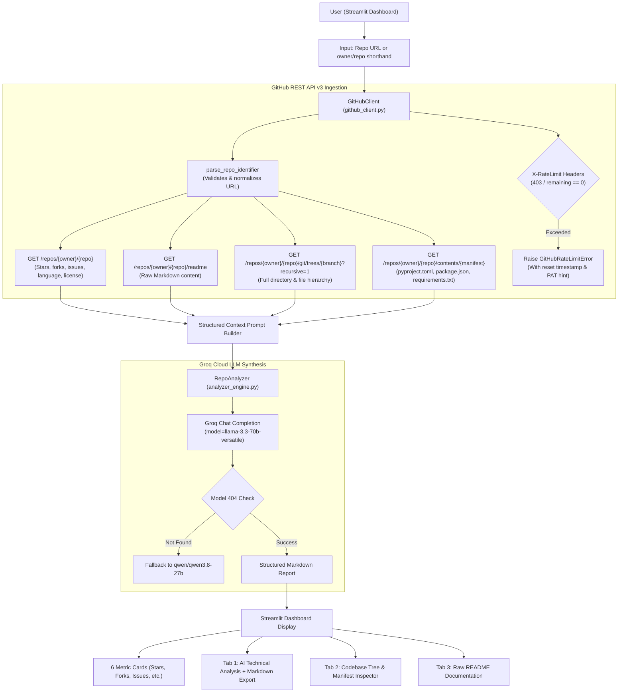

# Task 3: GitHub Repository AI Analyzer & Open-Source Contribution

A complete, production-ready, modular GitHub Repository AI Analyzer web application powered by the **GitHub REST API v3** and the **Groq Cloud API** (`llama-3.3-70b-versatile`, `qwen/qwen3.8-27b`, and `openai/gpt-oss-120b`). The application ingests public repositories, maps codebase organization, inspects package manifests, and synthesizes structured technical audits and actionable open-source contribution roadmaps.

---

## 🏗️ Architecture & Pipeline Flow



---

## 📁 Project Directory Structure

```
task-03-github-analyzer/
├── .env.example              # Environment variables template
├── requirements.txt          # Pinned production dependencies
├── github_client.py          # GitHub REST API client with rate-limiting resilience
├── analyzer_engine.py        # Technical audit engine using Groq LLM inference
├── app.py                    # Streamlit web dashboard with metrics, tabs, and export
├── README.md                 # Complete system documentation and architecture guide
└── tests/                    # Automated unit and integration test suite
    ├── conftest.py           # Pytest path and environment configuration
    ├── test_github_client.py # Tests for URL parsing, metadata, tree, and rate limits
    └── test_analyzer_engine.py # Tests for prompt construction, report synthesis, and fallback
```

---

## 🔌 GitHub REST API Endpoints & Rate-Limiting Strategy

### Endpoints Utilized:
1. **Repository Metadata:** `GET https://api.github.com/repos/{owner}/{repo}`
   - Ingests stars, forks, open issues count, watchers, default branch, primary language, license name, topics, and description.
2. **README Documentation:** `GET https://api.github.com/repos/{owner}/{repo}/readme`
   - Retrieved using header `Accept: application/vnd.github.raw` to fetch original Markdown.
3. **Recursive File Tree:** `GET https://api.github.com/repos/{owner}/{repo}/git/trees/{default_branch}?recursive=1`
   - Captures the complete file and directory hierarchy to analyze separation of concerns.
4. **Package Manifests:** `GET https://api.github.com/repos/{owner}/{repo}/contents/{path}`
   - Dispatches raw content queries for detected dependency descriptors (`pyproject.toml`, `requirements.txt`, `package.json`, `Cargo.toml`, `go.mod`, etc.).

### Rate-Limiting Strategy:
- **Unauthenticated Requests:** Limited to **60 requests/hour** per IP address.
- **Authenticated Requests:** Providing an optional `GITHUB_TOKEN` increases capacity to **5,000 requests/hour**.
- **Defensive Interception:** The client monitors `X-RateLimit-Remaining` and `X-RateLimit-Reset` response headers. When exhausted (HTTP 403), the client raises `GitHubRateLimitError`, formatting the exact UTC reset timestamp and advising the user to input a GitHub Personal Access Token in the UI sidebar.

---

## ⚡ Step-by-Step Local Setup & Execution

### 1. Prerequisites
- Python 3.10+ installed
- Free Groq Cloud API key from [https://console.groq.com/keys](https://console.groq.com/keys)
- (Optional) GitHub Personal Access Token from [https://github.com/settings/tokens](https://github.com/settings/tokens) (no special scopes needed for public repos)

### 2. Virtual Environment Setup
```bash
# Navigate to project directory
cd task-03-github-analyzer

# Create virtual environment
python -m venv .venv

# Activate virtual environment
# Windows (PowerShell):
.venv\Scripts\Activate.ps1
# Linux / macOS:
source .venv/bin/activate

# Install pinned dependencies
pip install -r requirements.txt
```

### 3. Environment Configuration
Create a `.env` file in `task-03-github-analyzer/` (or copy from `.env.example`):
```bash
cp .env.example .env
```
Populate `.env` with your API keys:
```env
GROQ_API_KEY=gsk_your_groq_api_key_here
GITHUB_TOKEN=optional_github_personal_access_token_here
```

### 4. Run the Streamlit Application
```bash
streamlit run app.py
```
Open your browser at `http://localhost:8501`.

### 5. Run the Automated Test Suite
```bash
pytest tests/ -v
```
All 12 test cases validate URL parsing, mocked REST responses, error handling, prompt construction, and model fallback logic.

---

## 🌟 Part B: Open-Source Contribution Requirement

As a GenAI & Open-Source Developer Intern, active engagement with the open-source community is essential.

### Recommended Contribution Workflow:
1. **Repository Selection:** Choose an established, active open-source project (e.g. `psf/requests`, `pallets/flask`, `tiangolo/fastapi`, `huggingface/transformers`, `langchain-ai/langchain`).
2. **Review Community Guidelines:** Inspect `CONTRIBUTING.md` and `CODE_OF_CONDUCT.md` to adhere strictly to the maintainers' development and style conventions.
3. **Identify Genuine Needs:**
   - **Bug Fix or Test Enhancement:** Reproduce an existing edge-case issue and contribute unit tests or bug fixes via Pull Request.
   - **Documentation Clarity:** Fix ambiguous documentation, dead links, or missing code samples.
   - **Type Annotations & Modernization:** Add missing PEP 484 type annotations or clean up deprecated syntax.
4. **Recording Submission:**
   - Record the target repository URL, direct issue/PR URL, and a brief description of the technical contribution in [`SUBMISSION.md`](file:///k:/code/ghanextech/SUBMISSION.md).
